# Hi, I'm Shun Takahashi 👋

Tokyo-based engineer who loves **AWS** and **Kubernetes**, and enjoys building and contributing to OSS in my free time.

## 🌱 Open Source Contributions

| Project | Role | Merged PRs |
| --- | --- | --- |
| [kubernetes-sigs/karpenter](https://github.com/kubernetes-sigs/karpenter) | Contributor | [View](https://github.com/kubernetes-sigs/karpenter/pulls?q=is%3Apr+author%3Amoko-poi+is%3Amerged) |
| [aws/karpenter-provider-aws](https://github.com/aws/karpenter-provider-aws) | Contributor | [View](https://github.com/aws/karpenter-provider-aws/pulls?q=is%3Apr+author%3Amoko-poi+is%3Amerged) |
| [kubernetes-sigs/karpenter-provider-cluster-api](https://github.com/kubernetes-sigs/karpenter-provider-cluster-api) | Contributor | [View](https://github.com/kubernetes-sigs/karpenter-provider-cluster-api/pulls?q=is%3Apr+author%3Amoko-poi+is%3Amerged) |
| [kubernetes-sigs/cluster-api-operator](https://github.com/kubernetes-sigs/cluster-api-operator) | Contributor | [View](https://github.com/kubernetes-sigs/cluster-api-operator/pulls?q=is%3Apr+author%3Amoko-poi+is%3Amerged) |
| [grafana/k6](https://github.com/grafana/k6) | Contributor | [View](https://github.com/grafana/k6/pulls?q=is%3Apr+author%3Amoko-poi+is%3Amerged) |
| [grafana/k6-operator](https://github.com/grafana/k6-operator) | Contributor | [View](https://github.com/grafana/k6-operator/pulls?q=is%3Apr+author%3Amoko-poi+is%3Amerged) |
| [valkey-io/valkey](https://github.com/valkey-io/valkey) | Contributor | [View](https://github.com/valkey-io/valkey/pulls?q=is%3Apr+author%3Amoko-poi+is%3Amerged) |

Also contributed to [argo-cd](https://github.com/argoproj/argo-cd), [terraform-provider-aws](https://github.com/hashicorp/terraform-provider-aws), [terraform-aws-eks](https://github.com/terraform-aws-modules/terraform-aws-eks), [pipecd](https://github.com/pipe-cd/pipecd), and [xk6](https://github.com/grafana/xk6).

## 🛠️ Projects

- [**xk6-valkey**](https://github.com/moko-poi/xk6-valkey) — k6 extension providing a Valkey client for load tests, powered by valkey-go
- [**serverless-k6-load-testing**](https://github.com/moko-poi/serverless-k6-load-testing) — Distributed load testing with k6 on AWS Lambda, provisioned by Terraform

## 📊 GitHub Stats

  <picture>
    <source media="(prefers-color-scheme: dark)" srcset="./profile/stats-dark.svg">
    
  </picture>
  <picture>
    <source media="(prefers-color-scheme: dark)" srcset="./profile/top-langs-dark.svg">
    
  </picture>

  <picture>
    <source media="(prefers-color-scheme: dark)" srcset="https://streak-stats.demolab.com/?user=moko-poi&theme=github-dark-blue&hide_border=true">
    
  </picture>
   
  <picture>
    <source media="(prefers-color-scheme: dark)" srcset="https://github-readme-activity-graph.vercel.app/graph?username=moko-poi&theme=github-dark&hide_border=true">
    
  </picture>

---

I'm not actively looking for a new role, but I'm always open to hearing about interesting opportunities.
